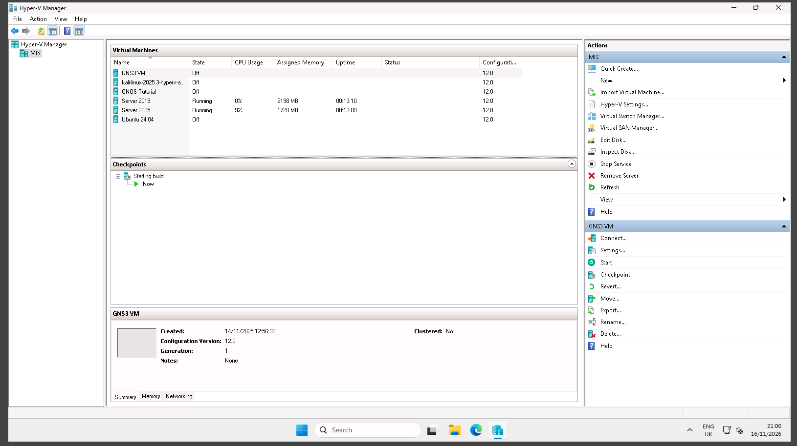

# Virtualisation and Hyper-V

**University:** Solent University  
**Course:** Network Applications  
**Topic:** Virtualisation and Hyper-V

## Overview

**Virtualisation** is a technology that allows multiple virtual computers to run on shared physical hardware.

A **Virtual Machine (VM)** is a software-based computer with its own operating system, virtual hardware and allocated resources.

A **Hypervisor** is the technology responsible for creating and managing virtual machines and allocating physical hardware resources.

## Microsoft Hyper-V

**Hyper-V** is Microsoft's virtualisation technology, available on supported Windows and Windows Server editions.

It enables administrators to run multiple operating systems, such as Windows Server and Linux, on the same physical host.

### Key Components

1. **Host:** The physical computer running the virtualisation platform.
- Example: The university computer named **MIS**, which hosts the virtual machines.

2. **Guest OS:** The operating system running inside a virtual machine.
- Example: Windows Server 2019, 2025 or Ubuntu 24.04 running inside a VM.

3. **Virtual Machine (VM):** A virtual computer with its own operating system and allocated resources.
- Example: The Server 2019, Server 2025 and Ubuntu 24.04 VMs listed in Hyper-V Manager.

4. **Hypervisor:** Software that manages virtual machines and hardware resources.
- The Hyper-V hypervisor running on the MIS host.

5. **Hyper-V Manager:** A graphical tool for creating, configuring and managing virtual machines.
- The application we opened on the LOD desktop to view and connect to the servers.

6. **Virtual Switch:** A software-based network switch that connects virtual machines to each other or other networks.
- A virtual switch configured in Hyper-V could allow Server 2025 and Ubuntu 24.04 to communicate over a network.

## Benefits of Virtualisation

- **Resource Efficiency:** Multiple virtual machines can share physical hardware.
- **Isolation:** Virtual machines operate in separate environments.
- **Flexibility:** Different operating systems can run on the same host.
- **Testing:** Administrators can experiment without directly modifying production servers.
- **Centralised Management:** Multiple virtual machines can be administered from one platform.

## Hyper-V in Our University Lab

During the Network Applications seminar, the university's Learning on Demand (LOD) environment provides access to Hyper-V Manager.

The Hyper-V host named **MIS** contains several virtual machines, including:

- Windows Server 2019
- Windows Server 2025
- Ubuntu 24.04

These virtual machines allow us to practise Windows and Linux server administration.

## Summary

Hyper-V provides a virtualised environment for running and managing multiple operating systems on shared hardware. Understanding hosts, guests, hypervisors and virtual machines is essential for practical server administration.