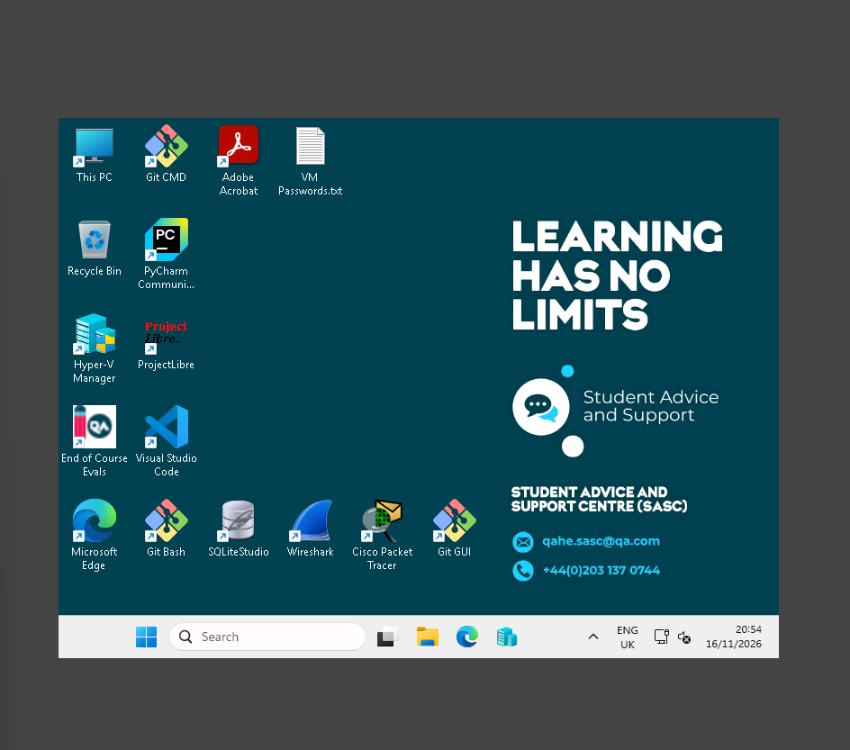
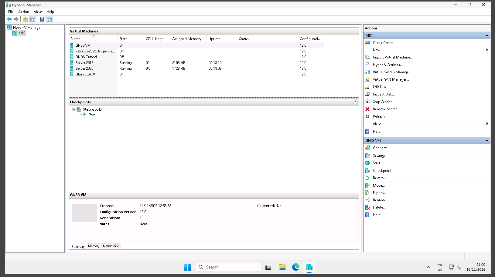
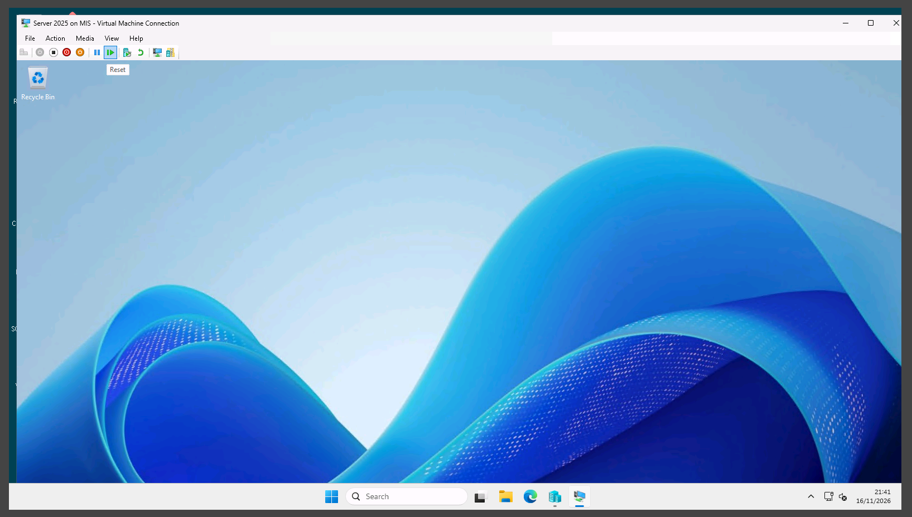

# Lab 01: Environment and Access

**Network Applications | Solent University**

## 🎯 Objective

- Access the university's Learning on Demand (LOD) environment and connect to the Windows Server virtual machine using Hyper-V.
- Become familiar with the lab environment before performing system administration and network diagnostic tasks.

## 🧪 Lab Implementation

### Step 1: Access the LOD Environment

Successfully logged in to the university's Learning on Demand (LOD) environment.

The remote desktop provides access to Hyper-V Manager and other tools used during the Network Applications practical sessions.

### Step 2: Open Hyper-V Manager

Opened Hyper-V Manager from the LOD desktop and connected to the available Hyper-V host (MIS).

The Virtual Machines panel displayed several Windows and Linux virtual machines, including Windows Server 2019, Windows Server 2025 and Ubuntu 24.04.

Both Windows Server virtual machines were already running.

### Step 3: Connect to Windows Server 2025

With Hyper-V Manager open, I connected to the Server 2025 virtual machine hosted on MIS.

Steps to connect:
- Open **Hyper-V Manager** and select the host `MIS`.
- Locate **Server 2025** and check that its status is **Running**.
- Right-click the virtual machine and select **Connect**.
- Sign in using the university-provided credentials.

After signing in, I accessed the Windows Server 2025 desktop and was ready to begin working inside the guest operating system.

## 🧰 Tools Used

- University Learning on Demand (LOD) Platform
- Hyper-V Manager
- Windows Server 2025

## 🔐 Security Relevance

- **Authentication:** User credentials are required to access the university lab environment.
- **Access Control:** Access to virtual machines and resources is restricted to authorised users.
- **Virtualisation:** Virtual machines provide an isolated environment for practising server administration.

## 📌 Lessons Learned

- Accessed the university's LOD environment.
- Used Hyper-V Manager to connect to a virtual machine.
- Identified `MIS` as the Hyper-V host and Windows Server 2025 as the guest operating system.
- Understood the importance of authentication when accessing server environments.