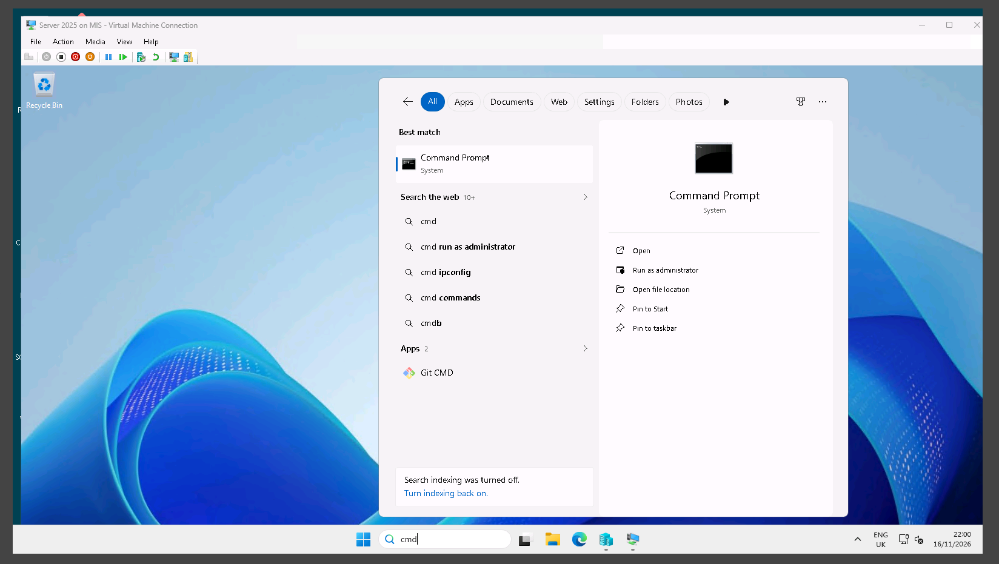
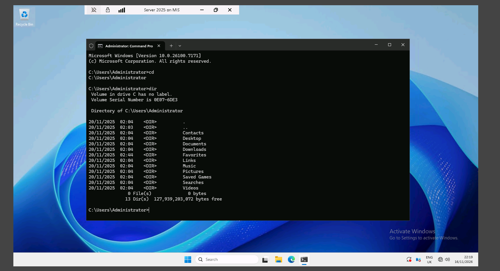
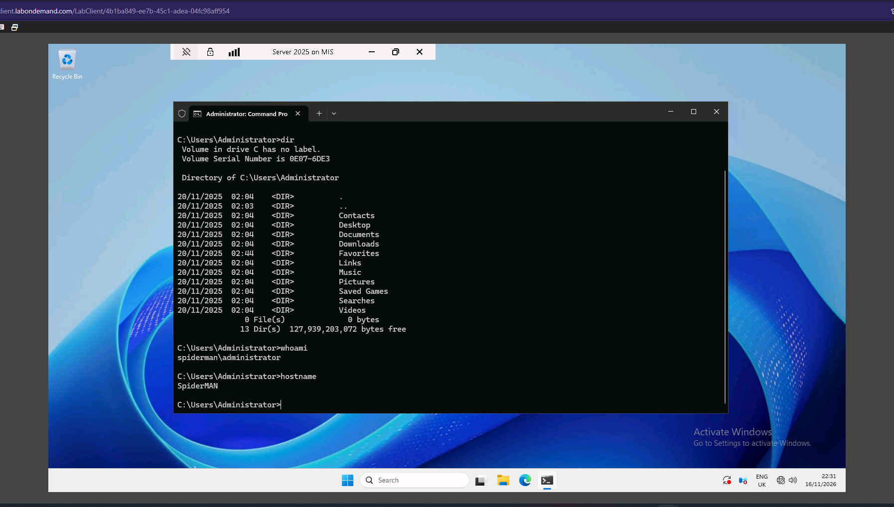

# Lab 02: System Navigation and Identity

**Network Applications | Solent University**

## 🎯 Objective

Learn to navigate the Windows Server file system using Command Prompt (CMD), identify the current user and computer, and understand basic system information.

## 🧪 Lab Implementation

### Step 1: Open CMD

Inside Windows Server 2025 virtual machine:
1. Open the **Start menu**.
2. Search for cmd.
3. Open the application.



### Step 2: Understanding Your Location

1. **Change Directory Command** `cd` - Where am I?
    - The `cd` command is used to navigate between directories.
    - When executed without arguments in CMD, it displays the current working directory.

```text
C:\Users\Administrator 
```
Currently inside the Administrator user's folder on the C: drive.

⚠️ Always know your location before creating or modifying files 

2. **Directory Listing Command** `dir` - What is inside this directory?
   - The `dir` command is used to list files and subdirectories.
   - When executed without arguments in CMD, it displays the contents of the current working directory.



Displays the files and folders inside `C:\Users\Administrator`, including their names, sizes and modification dates.

⚠️ Always check the contents of a directory before modifying or deleting files.

3. **Navigating Between Directories**
   - `cd Documents` — Moves into the Documents directory.
   - `cd ..` — Moves one level up to the parent directory.
   - `cd \` — Moves to the root directory of the current drive.
   - `cd C:\Users\Administrator` — Moves directly to the specified directory using its absolute path.

**Useful commands:**

| Command | Description |
|---|---|
| `cd` | Displays the current directory |
| `dir` | Lists files and subdirectories |
| `dir /a` | Lists all files, including hidden files |
| `dir /p` | Displays directory contents one page at a time |
| `cls` | Clears the command-line screen |

### Step 3: System Identity

Before performing administrative tasks, it is important to identify the current user account and the computer we are working on.

1. **Current User Command** `whoami` - Who am I?
   - The `whoami` command displays the identity of the currently logged-in user.
   - The output typically includes the computer or domain name followed by the username.

2. **Computer Name Command** `hostname` — Which computer am I working on?
   - The `hostname` command displays the name of the computer.
   - It helps administrators identify the system they are accessing, particularly in environments with multiple servers.



⚠️ Always verify your user identity and computer name before performing administrative tasks. Working on the wrong server or using the wrong account can lead to unintended changes.

## 🧰 Tools Used
- Command Prompt (CMD)
- University Learning on Demand (LOD) Platform
- Hyper-V Manager
- Windows Server 2025

## 🔐 Security Relevance
- **User Identity:** Identifying the current user helps administrators understand which account is being used to perform tasks.
- **System Identification:** Verifying the computer name reduces the risk of making changes on the wrong server.
- **Safe File Management:** Checking the current directory and its contents helps prevent accidental modification or deletion of files.
- **Least Privilege:** Administrative tasks should be performed using only the permissions necessary to complete them.

## 📌 Lessons Learned
- How to access and use Command Prompt (CMD) in Windows Server.
- How to identify the current working directory and list its contents.
- How to navigate the Windows file system using relative and absolute paths.
- How to identify the current user account and computer name.
- The importance of verifying system identity and directory location before performing administrative tasks.
