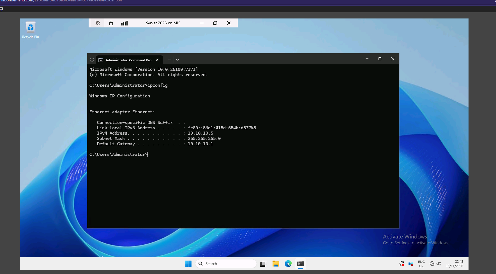
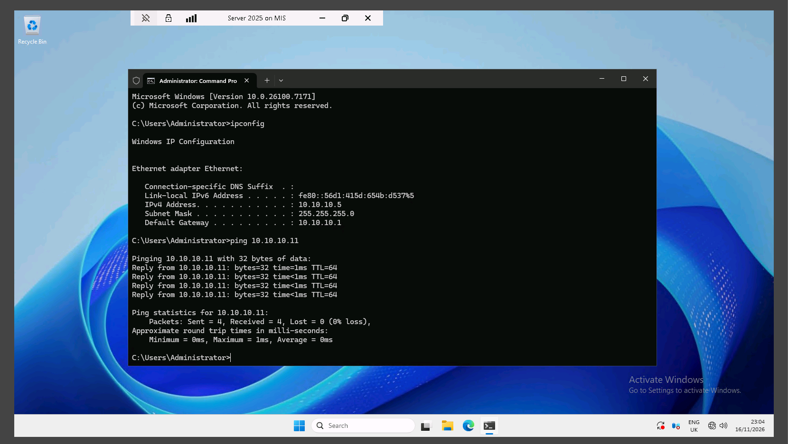

# Lab 03: Network Connectivity

**Network Applications | Solent University**

## 🎯 Objective

Learn to identify network configuration, test connectivity between computers and verify DNS resolution using Command Prompt (CMD) in Windows Server.

## 🧪 Lab Implementation

### Step 1: Check Network Configuration

Before testing network connectivity, it is important to understand the current network configuration of the computer.

1. **IP Configuration Command** `ipconfig` — What is my network configuration?
   - The `ipconfig` command displays basic IP configuration information.
   - It provides the IPv4 address, subnet mask and default gateway.

2. **Detailed IP Configuration Command** `ipconfig /all`
   - Displays detailed network configuration, including MAC addresses, DNS servers and DHCP information.



**Understanding the output:**

| Network Component | Description |
|---|---|
| IPv4 Address | The address used to identify and communicate with a device on a network. |
| Subnet Mask | Determines which IP addresses belong to the same local network. |
| Default Gateway | Usually the router that allows the device to communicate with other networks, including the Internet. |
| MAC Address | The physical or virtual hardware address of a network adapter. |
| DNS Server | Translates domain names (e.g. www.google.com) into IP addresses. |
| DHCP Server | Automatically assigns IP addresses and other network settings to devices. |

### Step 2: Test Network Connectivity

In this step, we test network communication between Windows Server and Linux Server using the ping command.

1. Identify the Linux Server IP Address
   - Open Hyper-V Manager.
   - Start the **Ubuntu 24.04 virtual machine**.
   - Open the Linux terminal.
   - Run the following command to identify its IP address:

```bash 
ip a 
```
* Alternatively, use `ifconfig`

    - Output: 10.10.10.11

2. **Packet Internet Groper Command** `ping` — Can I reach another device?
   - The `ping` command tests whether another network device responds to ICMP echo requests.
   - It displays response times and packet loss statistics.
   - `ping -t` - Continuously sends ICMP echo requests until stopped with Ctrl+C.



**Understanding the output:**

| Result | Description |
|---|---|
| Reply from | The destination responded successfully. |
| Time | Round-trip response time in milliseconds. |
| Request timed out | No response was received within the expected time. |
| Destination host unreachable | The destination could not be reached. |
| Packet loss | Percentage of transmitted packets for which no reply was received. |

⚠️ An unsuccessful ping does not necessarily mean a device is offline. Firewall rules may block ICMP traffic.

## 🧰 Tools Used
- Command Prompt (CMD)
- University Learning on Demand (LOD) Platform
- Hyper-V Manager
- Windows Server 2025
- Linux Server Ubuntu 24.04

## 🔐 Security Relevance
- **Network Identification:** Understanding IP configuration helps administrators identify network interfaces and configuration problems.
- **Network Monitoring:** Connectivity testing helps detect communication failures and service disruptions.
- **Firewall Configuration:** Firewalls can restrict network traffic, including ICMP requests.

## 📌 Lessons Learned
- How to identify the network configuration of Windows Server.
- How to identify IP addresses, subnet masks, gateways and DNS servers.
- How to test network connectivity using the `ping` command.
- How to interpret connectivity test results.