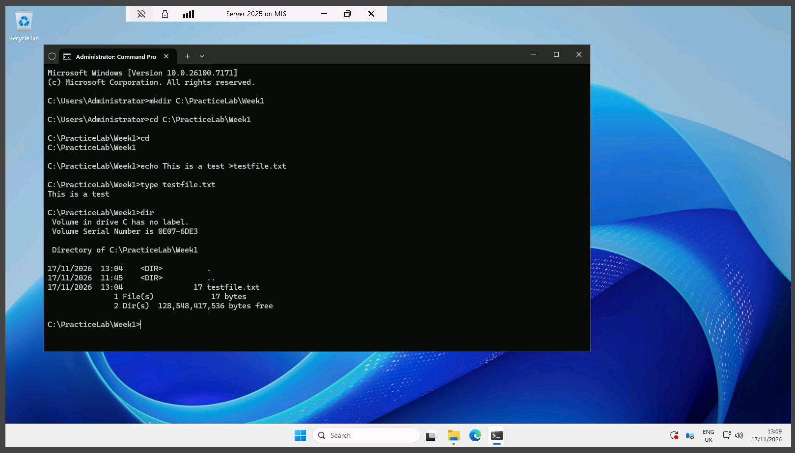
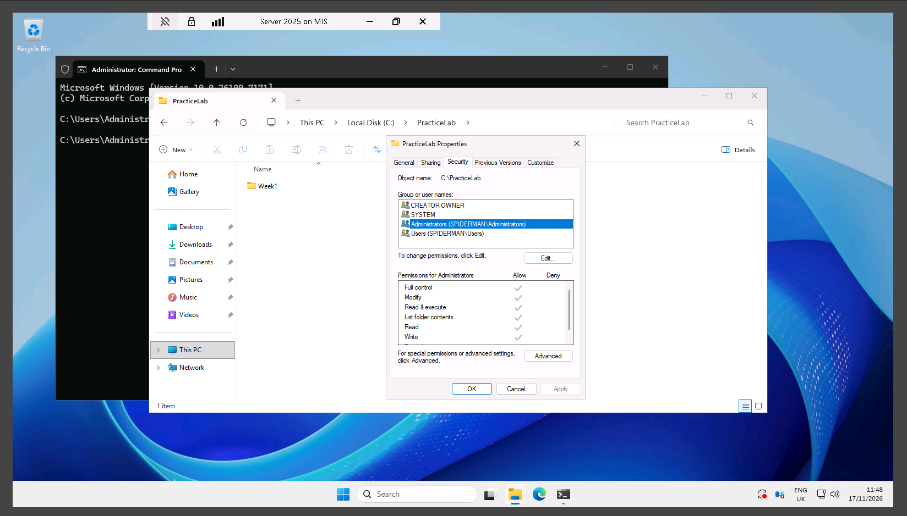
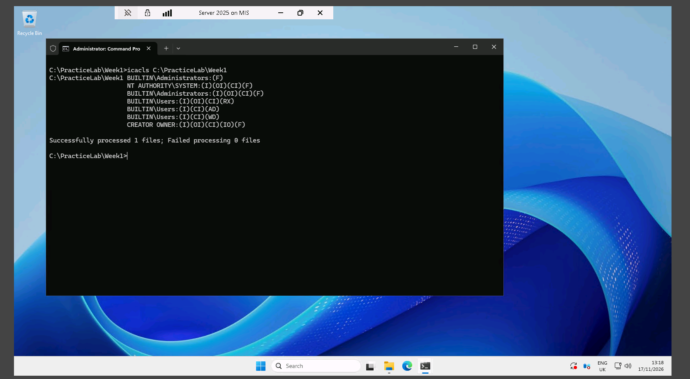

# Lab 04: Exploring File Systems and Permissions

**Network Applications | Solent University**

## 🎯 Objective

Learn to create directories in Windows Server, examine file system permissions and understand how access to files and folders is controlled.

## 🧪 Lab Implementation

### Step 1: Create a Directory

1. Open Command Prompt (CMD).
2. Create a practice directory.

**Make Directory Command** `mkdir` — How do I create a directory?
- The `mkdir` command is used to create new directories.

```cmd
mkdir C:\PracticeLab\Week1
```


### Step 2: Navigate into the Directory and Create a Test File

1. **Change Directory Command** `cd` — Navigate into the practice folder.
```cmd
cd C:\PracticeLab\Week1
```

Verify the current location:
```cmd
cd
```

**Output:**
```text
C:\PracticeLab\Week1
```

2. **Echo Command** `echo` — Create a file with content.
   - The `echo` command displays text.
   - The `>` redirection operator sends the output into a file instead of displaying it on the screen.

```cmd
echo This is a test > testfile.txt
```

This creates a file named `testfile.txt` containing the text "This is a test".

3. **Type Command** `type` — What is inside the file?
   - The `type` command displays the contents of a text file without opening a text editor.

```cmd
type testfile.txt
```

**Output:**

```text
This is a test
```

4. Verify that the file exists using the `dir` command.



⚠️ The `>` operator overwrites existing file contents. Use `>>` to append content without replacing existing text.

### Step 3: View Directory Permissions

#### 1. Check folder permissions (GUI method)
1. Open File Explorer.
2. Navigate to `C:\PracticeLab`.
3. Right-click the `Week1` folder.
4. Select **Properties**.
5. Open the **Security** tab.
6. Examine the users, groups and their assigned permissions.



**Understanding the permissions:**

| Permission | Description |
|---|---|
| Full Control | Allows complete control over files, folders and permissions. |
| Modify | Allows reading, editing and deleting files. |
| Read & Execute | Allows reading files and running programs. |
| List Folder Contents | Allows viewing files and folders inside a directory. |
| Read | Allows viewing file contents. |
| Write | Allows creating files and writing data. |

#### Check permissions (Command line method)

**Integrity Control Access Control List Command** `icacls` — Who has access to this directory?

- The `icacls` command displays and modifies NTFS file and directory permissions.
- It provides a quick way to check permissions without using the graphical interface.
- It is particularly useful for scripting and automating administrative tasks.

```cmd
icacls C:\PracticeLab\Week1
```



**Understanding the output:**

| Symbol | Meaning |
|---|---|
| (F) | Full Control |
| (M) | Modify |
| (R) | Read |
| (RX) | Read and Execute |
| (W) | Write |
| (AD) | Add Subdirectories |
| (WD) | Write Data / Add Files |
| (I) | Inherited Permission |
| (OI) | Object Inherit — files inherit this permission |
| (CI) | Container Inherit — subdirectories inherit this permission |
| (IO) | Inherit Only — applies to inheriting objects, not the current directory |

**Observations:**
- Administrators and SYSTEM have Full Control.
- Users have Read and Execute permissions, along with additional permissions to create files and subdirectories.
- CREATOR OWNER has an inherit-only Full Control entry.
- Entries marked with `(I)` are inherited from a parent directory.

⚠️ Running `icacls` without additional modification options displays existing permissions without changing them.

### Step 4: Understand Permission Inheritance

Permission inheritance allows files and subdirectories to automatically receive inheritable permissions from their parent directory.

In our example, the `Week1` folder can inherit permissions from the `PracticeLab` folder.

1. Open the **Security** tab of the `Week1` folder.
2. Select **Advanced**.
3. Examine the permission entries and the **Inherited from** column.


⚠️ Always review existing permissions before making changes.

## 🧰 Tools Used
- Command Prompt (CMD)
- Windows File Explorer
- University Learning on Demand (LOD) Platform
- Hyper-V Manager
- Windows Server 2025

## 🔐 Security Relevance
- **Access Control:** Permissions determine who can access and modify resources.
- **Least Privilege:** Users should receive only the permissions necessary to perform their tasks.
- **Data Protection:** Correct permissions help prevent unauthorised access, modification and deletion of files.

## 📌 Lessons Learned
- How to create directories using CMD.
- How to view directory permissions in Windows Server.
- How to identify users, groups and their assigned permissions.
- How permission inheritance works.
- The importance of permissions in securing network resources.