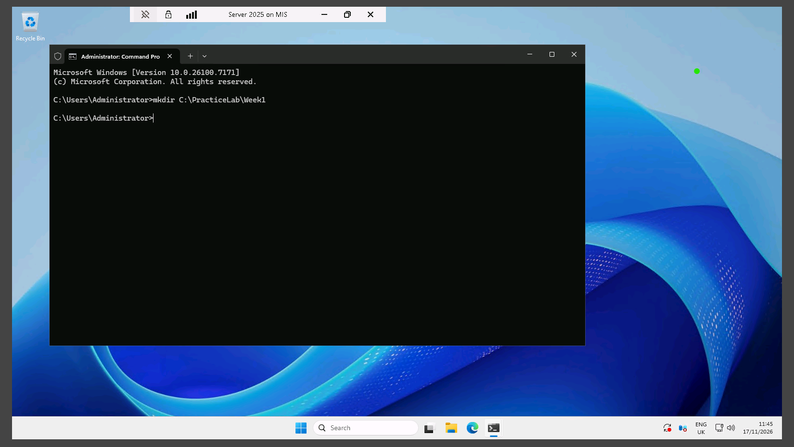
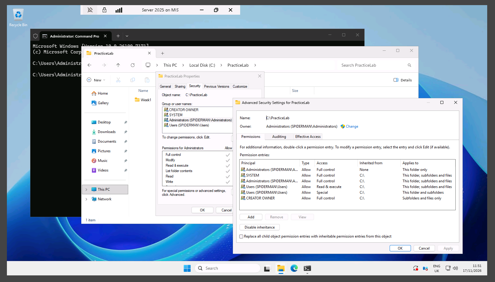

# Lab 04: Exploring File Systems and Permissions

**Network Applications | Solent University**

## 🎯 Objective

Learn to create directories in Windows Server, examine file system permissions and understand how access to files and folders is controlled.

## 🧪 Lab Implementation

### Step 1: Create a Directory

1. Open Command Prompt (CMD).
2. Create a practice directory.

**Make Directory Command** `mkdir` — How do I create a directory?
- The `mkdir` command is used to create new directories.

```cmd
mkdir C:\PracticeLab\Week1
```



### Step 2: View Directory Permissions

1. Open File Explorer.
2. Navigate to `C:\PracticeLab`.
3. Right-click the `Week1` folder.
4. Select **Properties**.
5. Open the **Security** tab.
6. Examine the users, groups and their assigned permissions.


**Understanding the permissions:**

| Permission | Description |
|---|---|
| Full Control | Allows complete control over files, folders and permissions. |
| Modify | Allows reading, editing and deleting files. |
| Read & Execute | Allows reading files and running programs. |
| List Folder Contents | Allows viewing files and folders inside a directory. |
| Read | Allows viewing file contents. |
| Write | Allows creating files and writing data. |

### Step 3: Understand Permission Inheritance

Permission inheritance allows files and subdirectories to automatically receive inheritable permissions from their parent directory.

In our example, the `Week1` folder can inherit permissions from the `PracticeLab` folder.

1. Open the **Security** tab of the `Week1` folder.
2. Select **Advanced**.
3. Examine the permission entries and the **Inherited from** column.



⚠️ Always review existing permissions before making changes.

## 🧰 Tools Used
- Command Prompt (CMD)
- Windows File Explorer
- University Learning on Demand (LOD) Platform
- Hyper-V Manager
- Windows Server 2025

## 🔐 Security Relevance
- **Access Control:** Permissions determine who can access and modify resources.
- **Least Privilege:** Users should receive only the permissions necessary to perform their tasks.
- **Data Protection:** Correct permissions help prevent unauthorised access, modification and deletion of files.

## 📌 Lessons Learned
- How to create directories using CMD.
- How to view directory permissions in Windows Server.
- How to identify users, groups and their assigned permissions.
- How permission inheritance works.
- The importance of permissions in securing network resources.