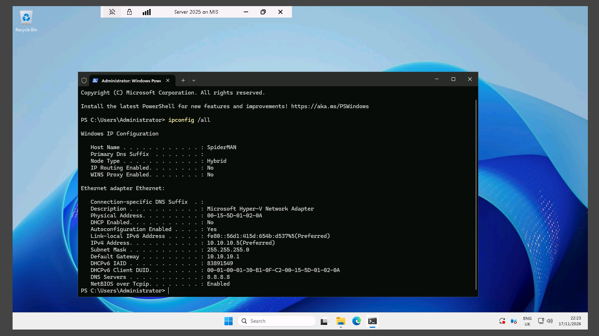
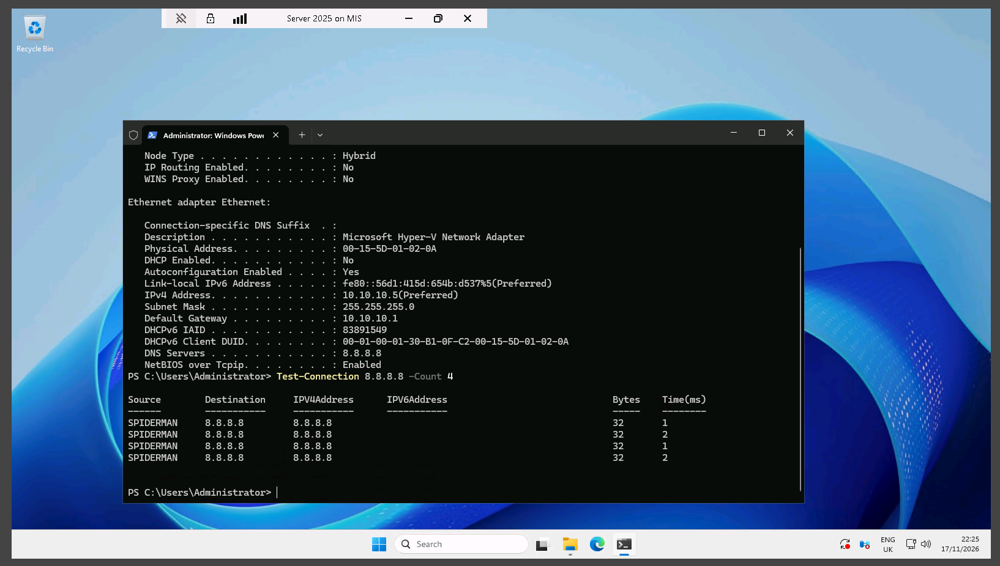
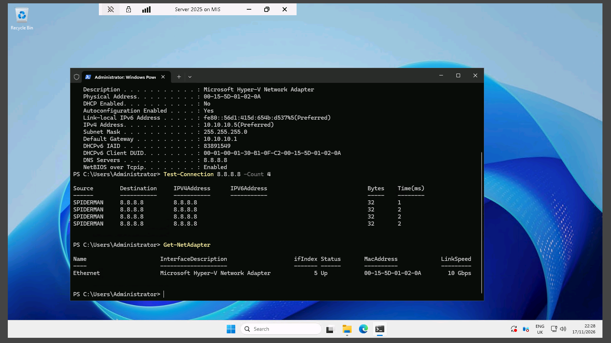
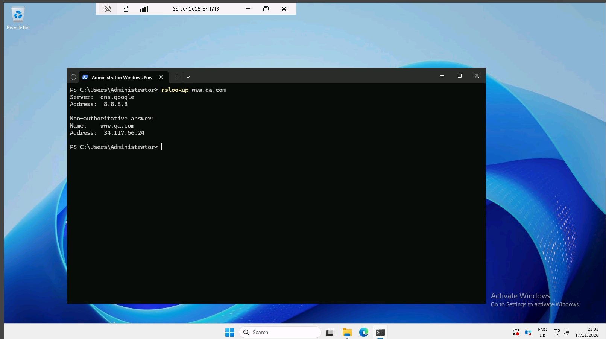

# Lab 05: Network Tools and Basic Diagnostics

**Network Applications | Solent University**

## 🎯 Objective

Learn to check network configuration, test external network connectivity and identify network adapter information using PowerShell in Windows Server.

## 🧪 Lab Implementation

### Step 1: Check Network Configuration

Inside Windows Server 2025 virtual machine:

1. Open the **Start menu**.
2. Search for PowerShell.
3. Open the application "Run as Administrator"

⚠️ Some network administration commands require PowerShell to run as Administrator.

**IP Configuration Command** `ipconfig /all`

- Displays detailed network configuration, including IP addresses, subnet masks, default gateways, MAC addresses and DNS servers.
- Although previously used in CMD, this command can also be executed in PowerShell.

```powershell
ipconfig /all
```



**Our server network configuration:**

| Network Component | Value |
|---|---|
| Hostname | SpiderMAN |
| IPv4 Address | 10.10.10.5 |
| Subnet Mask | 255.255.255.0 |
| Default Gateway | 10.10.10.1 |
| DNS Server | 8.8.8.8 |
| MAC Address | 00-15-5D-01-02-0A |
| DHCP Enabled | No |
| Network Adapter | Microsoft Hyper-V Network Adapter |

**Observations:**

1. Static and Dynamic IP Addresses

The server is configured with a static IPv4 address (10.10.10.5), as indicated by **DHCP Enabled: No.**

- Static IP (DHCP Enabled: No): The IP address is manually configured and remains the same unless changed.
- Dynamic IP (DHCP Enabled: Yes): The IP address is normally assigned automatically by a DHCP server.
- Preferred: Indicates that the IP address is valid and available for network communication.

Servers typically use static IP addresses because clients need a consistent address to access their services.

2. Subnet Mask (255.255.255.0)

The subnet mask determines which portion of the IP address identifies the network and which identifies the device.

In our configuration:
- Network address: 10.10.10.0
- Usable IP addresses: 10.10.10.1 – 10.10.10.254
- Broadcast address: 10.10.10.255

Our **Windows Server (10.10.10.5)** and **Linux Server (10.10.10.11)** are on the same subnet, assuming both use the same subnet mask.

3. Default Gateway (10.10.10.1)

The default gateway is the address of the device responsible for forwarding traffic to other networks (Router).

Communication within the local subnet does not normally require the default gateway.

Communication with external networks, such as the Internet, normally requires it.

4. DNS Server (8.8.8.8)

The server is configured to use Google's public DNS server.

- DNS translates domain names into IP addresses.
- Without working DNS resolution, we may still reach devices using their IP addresses but not their domain names.

5. MAC Address (00-15-5D-01-02-0A)

The MAC address identifies the network adapter at the data link layer and is used for communication within the local network.

Unlike an IP address, which is a logical network address, a MAC address is associated with a physical or virtual network adapter.

6. Network Adapter (NIC - Network Interface Card)

The Microsoft Hyper-V Network Adapter is a virtual network interface card (vNIC) provided by the Hyper-V virtualisation platform.

It allows our Windows Server virtual machine to communicate with other devices through a virtual switch.

### Step 2: Test External Network Connectivity

**Test Connection Command** `Test-Connection` — Can I reach an external destination?

- The `Test-Connection` cmdlet is the PowerShell equivalent of the `ping` command.
- It sends ICMP echo requests to a specified destination and displays the results.

```powershell
Test-Connection 8.8.8.8 -Count 4
```

The `-Count 4` parameter specifies the number of requests to send.



**Understanding the output:**

| Field | Description |
|---|---|
| Source | The computer sending the requests. |
| Destination | The address being tested. |
| IPv4Address | The destination IPv4 address. |
| IPv6Address | The destination IPv6 address, if available. |
| Bytes | The amount of data sent in each request. |
| Time(ms) | The round-trip response time in milliseconds. |

**Results:**

- Source: SPIDERMAN
- Destination: 8.8.8.8
- Requests sent: 4
- Replies received: 4
- Response time: 1–2 ms
- Packet loss: 0%

The successful replies confirm that Windows Server can communicate with the external IP address.

⚠️ Successful connectivity to an IP address does not necessarily confirm that DNS resolution or other network services are working correctly.

### Step 3: Check Network Adapter Status

**Get Network Adapter Command** `Get-NetAdapter` — Is my network adapter working?

- The `Get-NetAdapter` cmdlet displays information about network adapters.
- It helps administrators identify network interfaces, their status, MAC addresses and link speeds.

```powershell
Get-NetAdapter
```



**Understanding the output:**

| Field | Description | Our Result |
|---|---|---|
| Name | Name of the network adapter. | Ethernet |
| InterfaceDescription | Description of the network adapter. | Microsoft Hyper-V Network Adapter |
| ifIndex | Number used to identify the network interface. | 5 |
| Status | Current connection status. | Up |
| MacAddress | Hardware address of the adapter. | 00-15-5D-01-02-0A |
| LinkSpeed | Reported connection speed. | 10 Gbps |

**Observations:**

- The network adapter (NIC) has an active network link, as indicated by `Status: Up`.
- The server uses a virtual network adapter (vNIC) provided by Hyper-V.
- The reported link speed is 10 Gbps, which does not necessarily represent the actual network throughput or Internet connection speed.

### Step 4: Test DNS Resolution

**Name Server Lookup Command** `nslookup` — Is DNS resolution working?

- The `nslookup` command queries DNS servers to obtain information about domain names and their associated IP addresses.
- It helps administrators identify and troubleshoot DNS resolution issues.
- Like `ipconfig`, it is a traditional command that can also be executed in PowerShell.

```powershell
nslookup www.qa.com
```



**Understanding the output:**

| Field | Description | Our Result |
|---|---|---|
| Server | Name of the DNS server responding to our query. | dns.google |
| Address | IP address of our DNS server. | 8.8.8.8 |
| Answer Type | Indicates whether the answer comes directly from an authoritative DNS server. | Non-authoritative |
| Name | The domain name we are trying to resolve. | www.qa.com |
| Address | The resolved IP address of the domain. | 34.117.56.24 |

**Observations:**

When we executed `nslookup www.qa.com`, the following process took place:

1. Our Windows Server sent a DNS query to Google's public DNS server (8.8.8.8), asking for the IP address associated with www.qa.com.
2. Google's DNS server acted as a recursive DNS resolver, checking its cache or querying other DNS servers to obtain the requested IP address.
3. Google's DNS server returned the IPv4 address 34.117.56.24 to our Windows Server.
4. PowerShell displayed the result as a non-authoritative answer.

**Understanding the results:**

- **Recursive DNS Resolver:** A DNS server that finds IP addresses on behalf of clients.
- **DNS Cache:** Temporarily stores previous DNS results to speed up future requests.
- **Authoritative Answer:** A response provided directly by a DNS server responsible for the domain's DNS records.
- **Non-authoritative Answer:** A response provided by a DNS resolver that is not directly responsible for the domain. This is normal and does not indicate an error.

Our successful DNS query confirms that Windows Server can communicate with its configured DNS server and resolve the requested domain name.

⚠️ We used Google's DNS service, not Google's search engine. We did not access the QA website itself; we only requested its IP address.

⚠️ If connectivity to an external IP address works but DNS resolution fails, this may indicate a DNS configuration or communication problem.

## 🧰 Tools Used

- PowerShell
- University Learning on Demand (LOD) Platform
- Hyper-V Manager
- Windows Server 2025

## 🔐 Security Relevance

- **Network Configuration:** Reviewing network settings helps identify incorrect or unauthorised configurations.
- **Network Diagnostics:** Connectivity testing helps identify communication failures and network disruptions.
- **Network Interface Monitoring:** Checking network adapters helps identify inactive or unexpected interfaces.
- **DNS Configuration:** Reviewing configured DNS servers helps identify potentially unauthorised DNS changes.

## 📌 Lessons Learned

- How to check detailed network configuration using PowerShell.
- How to distinguish between static and dynamic IP configurations using the DHCP status.
- How to identify the network address, usable IP range and broadcast address using the subnet mask.
- How the default gateway enables communication between different networks.
- The purpose of DNS servers, MAC addresses and network adapters (NICs).
- How to test external network connectivity using `Test-Connection`.
- How to interpret response times and connectivity results.
- How to check network adapter status using `Get-NetAdapter`.
- How PowerShell can be used for basic network diagnostics.